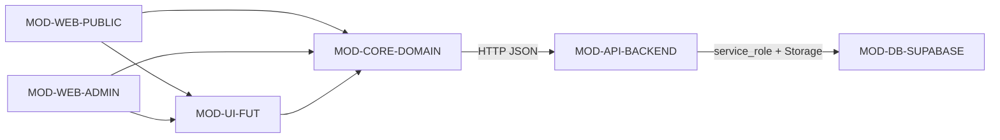

# Inventario de Código — FUT (FUT Pachangas)

Fecha de indexación: `2026-11-26` (medido sobre el árbol actual de `src/` y `supabase/`).

## Lenguaje y stack
- **Lenguaje:** TypeScript `^5.7.0`
- **Framework:** Next.js `^15.2.0` (App Router) + React `^19.0.0`
- **Estilos y UI:** Tailwind CSS `^4.0.0`, `framer-motion` `^12.4.7`, `lucide-react` `^0.475.0`
- **Exportación visual:** `html-to-image` `^1.11.13`, `html2canvas` `^1.4.1`
- **Backend / Persistencia:** Supabase (`@supabase/supabase-js` `^2.49.1`, PostgreSQL + Storage bucket `avatars`)
- **Notificaciones:** `nodemailer` `^10.6.1` (SMTP Gmail)
- **Build / Despliegue:** `next build` · Vercel (`vercel.json` con cron diario)

## Estructura general
```text
FUT/
  src/
    app/                    # Páginas App Router (públicas, admin) y API Route Handlers
      api/                  # /api/db, /api/notifications/send, /api/cron/keep-alive
      admin/                # Dashboard, login, gestión de jugadores y partidos
      auth/ · players/ · profile/ · stats/ · vote/
    components/
      fut/                  # FutCard (carta estilo EA FC), PlayerCardModal (3D + PNG)
      layout/               # BottomNav, InstallAppBanner (PWA)
    lib/                    # Store global React, reglas de progresión/bonus, balanceo, fotos, mailer, Supabase
    types/                  # Contratos de dominio y helpers puros (fut.ts)
  supabase/
    schema.sql              # Esquema relacional PostgreSQL, RLS y permisos
```

## Módulos detectados

### MOD-WEB-PUBLIC — Páginas Públicas y de Jugador
- **Ruta:** `src/app/` (excluyendo `admin/` y `api/`)
- **Ficheros:** 9 (`layout.tsx`, `globals.css`, `manifest.ts`, `page.tsx`, `auth/page.tsx`, `players/page.tsx`, `profile/page.tsx`, `stats/page.tsx`, `vote/page.tsx`, `vote/[matchId]/page.tsx` — 10 con `globals.css`)
- **Líneas medidas:** ~2.694
- **Interfaces:** Rutas Next.js `/`, `/auth`, `/players`, `/profile`, `/stats`, `/vote`, `/vote/[matchId]`
- **Dependencias:** `MOD-UI-FUT`, `MOD-CORE-DOMAIN`
- **Propósito:** Convocatorias abiertas con cuenta atrás y auto-inscripción, registro/login de jugadores, perfil editable con foto, álbum FUT, rankings/historial y votación MVP.

### MOD-WEB-ADMIN — Panel de Administración
- **Ruta:** `src/app/admin/`
- **Ficheros:** 5 (`page.tsx`, `login/page.tsx`, `players/page.tsx`, `matches/new/page.tsx`, `matches/[id]/page.tsx`)
- **Líneas medidas:** ~2.312
- **Interfaces:** Rutas Next.js `/admin`, `/admin/login`, `/admin/players`, `/admin/matches/new`, `/admin/matches/[id]`
- **Dependencias:** `MOD-UI-FUT`, `MOD-CORE-DOMAIN`
- **Propósito:** Gestión CRUD de jugadores/cartas (modal + FAB `+`), creación y edición de partidos, autobalanceo de equipos, registro de goles/asistencias, cierre de votación/progresión y envío de correo de prueba.

### MOD-UI-FUT — Componentes Visuales y Layout
- **Ruta:** `src/components/`
- **Ficheros:** 4 (`fut/FutCard.tsx`, `fut/PlayerCardModal.tsx`, `layout/BottomNav.tsx`, `layout/InstallAppBanner.tsx`)
- **Líneas medidas:** 1.438
- **Interfaces:** Componentes React `FutCard`, `PlayerCardModal`, `BottomNav`, `InstallAppBanner`
- **Dependencias:** `MOD-CORE-DOMAIN`
- **Propósito:** Renderizado de cartas FUT por rareza (`bronze`, `silver`, `gold`, `totw`, `tots`, `icon`), modal 3D con exportación a PNG, navegación inferior responsive y banner de instalación PWA.

### MOD-CORE-DOMAIN — Dominio, Estado Cliente y Lógica de Negocio
- **Ruta:** `src/types/` + `src/lib/` (excepto `supabase/` y `mailer.ts`)
- **Ficheros:** 9 (`types/fut.ts`, `lib/store.tsx`, `lib/progression.ts`, `lib/rating-bonus.ts`, `lib/team-balancer.ts`, `lib/match-phase.ts`, `lib/image-resize.ts`, `lib/notify-client.ts`, `lib/validation.ts`)
- **Líneas medidas:** 2.648
- **Interfaces:** Contexto `FutStoreProvider` / `useFutStore()`, funciones puras (`computeOverall`, `computePlayerPerformanceBonus`, `applyMatchProgression`, `balanceTeams`, `getEffectiveMatchPhase`, `processAvatarImage`)
- **Dependencias:** `MOD-API-BACKEND` (vía `fetch("/api/db")` y `fetch("/api/notifications/send")`)
- **Propósito:** Estado global hidratado desde servidor con caché `localStorage`, cálculo dinámico de bonus de forma (últimos 5 partidos), progresión post-partido, algoritmo exacto de balanceo de equipos y compresión de avatares en navegador.

### MOD-API-BACKEND — API Route Handlers y Servicios de Servidor
- **Ruta:** `src/app/api/` + `src/lib/supabase/` + `src/lib/mailer.ts`
- **Ficheros:** 6 (`api/db/route.ts`, `api/notifications/send/route.ts`, `api/cron/keep-alive/route.ts`, `lib/supabase/server.ts`, `lib/supabase/client.ts`, `lib/mailer.ts`)
- **Líneas medidas:** 1.002
- **Interfaces:**
  - `GET /api/db` — Snapshot completo del club (sin `password`)
  - `POST /api/db` — RPC por acción (`registerPlayer`, `loginPlayer`, `updateOwnProfile`, `upsertPlayer`, `deletePlayer`, `createMatch`, `updateMatchDetails`, `deleteMatch`, `upsertMatchPlayer`, `removeMatchPlayer`, `updateMatchTeams`, `updateMatchScoreAndGoals`, `castMvpVote`, `closeMatch`)
  - `POST /api/notifications/send` — Envío de correos (`welcome`, `new_match`, `mvp_award`, `test`)
  - `GET /api/cron/keep-alive` — Ping diario a Supabase (protegido opcionalmente con `CRON_SECRET`)
- **Dependencias:** `MOD-DB-SUPABASE`, Gmail SMTP
- **Propósito:** Capa BFF en Next.js Node.js runtime que opera sobre Supabase con `service_role`, sube avatares a Storage (`avatars`) y envía correos HTML con Nodemailer.

### MOD-DB-SUPABASE — Esquema Relacional y Persistencia
- **Ruta:** `supabase/`
- **Ficheros:** 1 (`schema.sql`)
- **Líneas medidas:** 144
- **Interfaces:** Tablas `players`, `matches`, `match_players`, `match_votes`, `match_ratings`, `player_rating_history`, `subscribers`; Storage bucket público `avatars`.
- **Dependencias:** Ninguna (capa base)
- **Propósito:** Persistencia PostgreSQL con columna generada `players.overall`, integridad referencial en cascada y políticas RLS.

## Dependencias entre módulos

