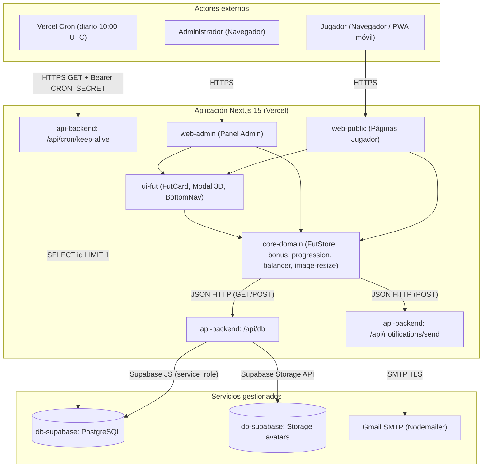

# SAD — Visión General y Taxonomía de Componentes (FUT)

## Propósito del sistema
**FUT (FUT Pachangas)** es una aplicación web fullstack (PWA) para gestionar partidos amistosos de fútbol ("pachangas") con estética de cartas estilo FIFA / EA FC Ultimate Team: convocatorias abiertas con auto-inscripción por equipo, autobalanceo por media, votaciones MVP post-partido, cartas dinámicas con estado de forma y notificaciones por correo.

## Taxonomía de componentes (Fuente de verdad)

Todos los niveles inferiores (`SSRS`, `SSD`, `SWDD`) se organizan estrictamente según estas categorías:

| Categoría | Identificador | Qué agrupa | Ubicación en código |
|---|---|---|---|
| **Web Pública** | `web-public` | Páginas de jugador: convocatorias (`/`), acceso (`/auth`), perfil (`/profile`), álbum (`/players`), rankings (`/stats`) y votaciones (`/vote`) | `src/app/` (sin `admin/`, `api/`) |
| **Web Admin** | `web-admin` | Panel de administración: dashboard, login, gestión de jugadores (modal + FAB `+`), creación y control de partidos | `src/app/admin/` |
| **UI Compartida** | `ui-fut` | Renderizado de cartas FUT, modal interactivo 3D + exportación PNG, navegación inferior y banner PWA | `src/components/` |
| **Dominio y Estado** | `core-domain` | Store cliente (`FutStoreProvider`), cálculo de estado de forma, progresión post-partido, balanceador de equipos, fases de partido y reescalado de fotos | `src/lib/` + `src/types/fut.ts` |
| **Backend BFF** | `api-backend` | Route Handlers de Next.js (`/api/db`, `/api/notifications/send`, `/api/cron/keep-alive`), cliente Supabase servidor y servicio Nodemailer | `src/app/api/` + `src/lib/supabase/` + `src/lib/mailer.ts` |
| **Persistencia** | `db-supabase` | Esquema relacional PostgreSQL (7 tablas), políticas RLS y bucket público de avatares | `supabase/schema.sql` + Supabase Storage |

## Diagrama de arquitectura

## Roles del sistema
- **Visitante anónimo:** consulta convocatorias abiertas, álbum de cartas y rankings/historial.
- **Jugador registrado:** gestiona su perfil y foto, se apunta/cambia/desapunta en partidos abiertos y emite voto MVP (sin autovoto) durante la ventana de 7 días tras el inicio del partido.
- **Administrador:** crea/edita/elimina jugadores y cartas (medias 1–99 y rarezas especiales), gestiona partidos, autobalancea equipos, registra goles/asistencias y cierra partidos aplicando la progresión de forma y MVP/TOTW.

## Decisiones y deuda técnica conocida
- **Progresión y estado de forma:** documentado en [`ADR-001`](../../decisions/ADR-001-progresion-y-bonus-rendimiento.md).
- **Deuda técnica de seguridad (aparcada — Bloque 2):**
  1. `POST /api/db` y `POST /api/notifications/send` operan sin autenticación de servidor; las credenciales admin actuales viven en cliente (`src/lib/store.tsx`).
  2. `players.password` se almacena en texto plano y la policy `Public read players` (`FOR SELECT USING (true)`) expone las columnas de `players` vía `anon` key.
  3. `GET /api/db` devuelve `subscribers` y `players.email` al cliente público.
- **Deuda funcional menor:** `match_ratings` existe en `supabase/schema.sql` pero no se consume en la versión actual (solo se usan votos MVP y estadísticas de goles/asistencias/victorias); `addSubscriber` solo actualiza estado local.
